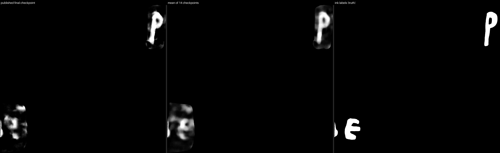
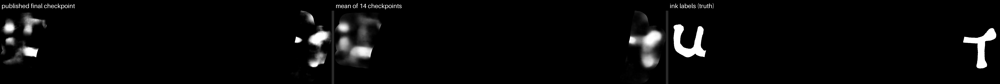
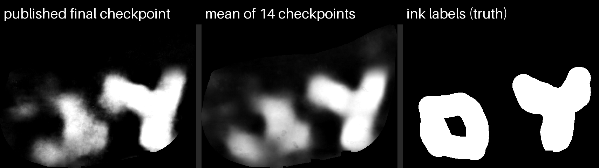

# Checkpoint averaging for the 9 µm ink models

By Gowtham Kumar Solleti, November 2026. A Vesuvius Challenge Progress Prize submission.

Averaging the predictions of all 14 published `scrollprize/ink_9um` checkpoints, with no training and no checkpoint picking, reads the held-out validation regions clearly better than any single checkpoint. Mean ROC-AUC rises from **0.839** with the final seed-42 checkpoint to **0.923**.

| Inference | mean ROC-AUC | mean average precision | mean balanced acc @0.5 |
|---|---|---|---|
| seed42 step-075000 (final checkpoint) | 0.839 | 0.732 | 0.735 |
| best single checkpoint, picked with hindsight (seed43 step-075000) | 0.910 | 0.810 | 0.807 |
| both final checkpoints (seed42 + seed43 step-075000) | 0.910 | 0.819 | 0.772 |
| **mean of all 14 checkpoints** | **0.923** | **0.844** | **0.798** |

Per region, all-14 vs the seed42 final checkpoint (ROC-AUC):

| region | final ckpt | all 14 |
|---|---|---|
| PHerc. 0139 `pherc0139-w016` | 0.774 | 0.927 |
| PHerc. 0814 `pherc0814-46527` | 0.874 | 0.901 |
| Scroll 1667 `pherc1667-w029` | 0.870 | 0.942 |





Panels show the published final checkpoint, then the mean of 14 checkpoints, then the ink labels. Each panel is masked to the validation region and displayed as `(p − 0.25) / 0.5`, following the model card.

## How it was measured

- **Data:** the three segments in `ink_9um/labels/aligned-scrollprizeorg-21slices` that ship a `_validation_mask.zarr`. These are the online-validation cases the released checkpoints report metrics on, and they are excluded from training.
- **Inputs:** each surface volume was built from its public 2.399 µm source with the repo's own `prepare_9um_isotropic_input` (level 2, 4× z mean-pool, 21 slices).
- **Inference:** `vesuvius.ink_detection.inference.infer` at default settings (layers 2–18, overlap 0.5, Hann blending), run over the bounding box of each validation region with `--roi`.
- **Metrics:** computed only on pixels inside the validation mask, against the ink label plane (z = 10); see `score.py`.
- **No selection on the test regions.** The headline uses every published checkpoint with equal weight. As a check, choosing the top-k checkpoints on two regions and scoring on the third (leave-one-region-out, k = 1, 3, 5) gave 0.906–0.912, below the plain mean.
- **Things that did not help on top of the mean:**
  - mirror test-time augmentation (`--tta-mirror`): 0.920 alone, 0.924 combined, at twice the compute;
  - averaging over shifted 17-slice depth windows: no gain.

The full per-checkpoint table is in `per_checkpoint_auc.md`, and every run is in `scores_all_runs.jsonl`.

## Reproduce

From `villa/vesuvius` (with `uv sync --extra models`):

```bash
hf download scrollprize/ink_9um --local-dir ink_9um_models
M=ink_9um_models
uv run python -m vesuvius.ink_detection.inference.infer \
  SURFACE_VOLUME.zarr $M/hybrid_3d2d-seed42/step-010000.pth out.tif \
  $(for s in 42 43; do for t in 010000 020000 030000 040000 050000 060000 075000; do
      [ $s$t = 42010000 ] || echo --ensemble-checkpoint $M/hybrid_3d2d-seed$s/step-$t.pth; done; done)
```

This uses the existing `--ensemble-checkpoint` option, so no code changes are needed. Cost is 14× a single model; a full ~6k × 8k segment takes about 15 min per checkpoint on an Apple M4 (MPS).

Score a prediction made over a validation region's bounding box (`val_roi.json` gives `--roi` per segment):

```bash
python score.py ink_9um/labels/aligned-scrollprizeorg-21slices/<segment> pred.tif
```

## Limits

- **Small test set:** three validation regions totalling about 720k pixels across three scrolls. The gain is consistent across all three, but the absolute numbers are noisy.
- **Pixel metrics, not legibility:** AUC and AP are pixel-level, not letter legibility.
- **Run on Apple Silicon:** everything here ran on an Apple M4 Mac (MPS). No CUDA results.

## Credits

The models, labels and inference code are by the Vesuvius Challenge team and contributors ([villa](https://github.com/ScrollPrize/villa), [scrollprize/ink_9um](https://huggingface.co/scrollprize/ink_9um)). This work only evaluates and combines their published checkpoints. MIT license.
